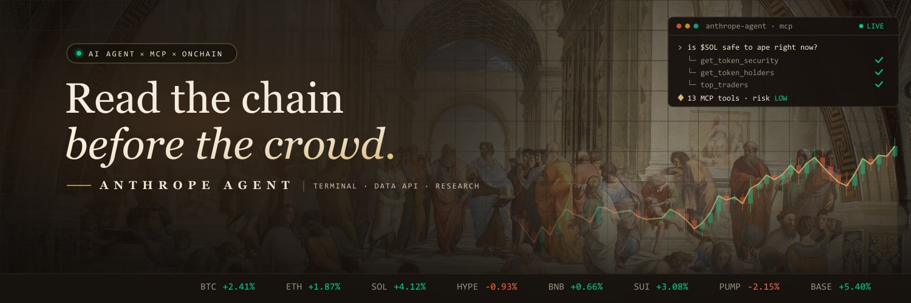

<p align="center">
  
</p>

<p align="center">
  
</p>

<h1 align="center">Anthrope Agent</h1>

<p align="center">
  <b>Onchain intelligence for traders and AI agents.</b><br />
  A live market terminal, an AI analyst, a data API and an MCP server, on one domain.
</p>

<p align="center">
  <a href="https://www.npmjs.com/package/anthrope-agent-mcp"></a>
  <a href="https://x.com/anthropeagent"></a>
  
  
</p>

---

## What it is

Anthrope Agent reads public blockchains and DEX markets and turns them into something a person or an AI agent can act on: prices, liquidity, holders, security scans, wallet profiles, top traders, pump.fun trenches and Hyperliquid perps.

It is **read-only and non-custodial**. It never holds your keys or funds; every swap is signed in your own wallet.

| Product | What you get |
| --- | --- |
| **Terminal** | Discover (trending, new, top market cap, RWA), token pages with live charts, trades, holders and security, wallet profiles, top traders, trenches, perps and alerts. Updates stream over WebSocket. |
| **AI Analyst** | Ask in plain words ("is this token safe?"). Claude reads the live data and explains what it sees. Runs in your browser with your own Anthropic key, which never touches our servers. |
| **MCP server** | [`anthrope-agent-mcp`](apps/mcp): 13 read-only tools that give Claude Desktop, Claude Code, Cursor and any MCP client the same live data. |
| **Data API** | REST `/api/v1` and WebSocket `/ws` with API keys and per-plan rate limits. |
| **Research** | Reports and blog posts, managed from a built-in CMS at `/admin`. |
| **Peak** | Institutional dashboard modules built on the same data. |

## MCP server in 30 seconds

```sh
claude mcp add anthrope-agent \
  -e ANTHROPE_API_KEY=ak_... \
  -e ANTHROPE_API_URL=https://YOUR-DOMAIN/api/v1 \
  -- npx -y anthrope-agent-mcp
```

Then ask Claude: *"Check BONK on Solana: security, holder concentration and what top traders are doing."*
Full tool list and Claude Desktop / Cursor config: [apps/mcp/README.md](apps/mcp/README.md).

## Architecture

```text
            browser ──► Next.js (apps/web) ──► /api/v1, /ws ──► Fastify (apps/api)
                                                                    │
  GeckoTerminal, DEX Screener, GoPlus,      workers (apps/workers) ─┤──► Postgres · Redis · ClickHouse
  Hyperliquid, pump.fun, Jupiter, Kyber ──► provider bridge ────────┘
                                                                    ▲
  Claude / Cursor ──► MCP server (apps/mcp) ──── x-api-key ─────────┘
```

```text
apps/
  web/        Next.js 15 (App Router, React 19, Tailwind v4): hub, terminal, analyst, research, admin
  api/        Fastify REST /api/v1 and WebSocket /ws, wallet sign-in, API keys, CMS, swap builder
  workers/    Background jobs: provider bridge, scans, trenches, perps, alerts
  mcp/        MCP server (published to npm as anthrope-agent-mcp)
packages/
  types/      Shared types
  db/         Postgres / ClickHouse / Redis clients and SQL migrations
  bridge/     Provider adapters, normalized into one token model
  devdb/      Postgres (PGlite) + in-memory Redis for local development without Docker
infra/        docker-compose and Caddyfile for a single-domain production setup
docs/         Architecture, API contract (OpenAPI + WebSocket), development guide
```

## Run it locally

Requires **Node.js 20+**. Docker is optional.

```sh
npm install
cp .env.example .env

# with Docker
npm run db:up
# or without Docker (Windows without WSL)
npm run db:local            # keep this running in its own terminal

npm run db:migrate
npm run dev                 # web :3000, api :4000, workers
```

Open <http://localhost:3000>. The first live data arrives about a minute after the workers start. To run the UI with sample data and no database, set `NEXT_PUBLIC_MARKET_DATA=mock` in `.env`.

| Command | What it does |
| --- | --- |
| `npm run typecheck` | Typecheck every workspace |
| `npm run lint` | Lint the web app |
| `npm test` | Run all tests |
| `npm run build` | Production build of web and api |

More detail (data sources, limits per provider, admin setup) is in [docs/DEVELOPMENT.md](docs/DEVELOPMENT.md) and [docs/ARCHITECTURE.md](docs/ARCHITECTURE.md).

## Security

- Wallet sign-in uses a signed message (SIWS / SIWE). No transaction, no fee, no private key.
- Swaps are built and simulated server-side, then signed in your wallet. Platform fee is 0%.
- API keys are stored only as SHA-256 hashes.
- Secrets live in `.env`, which is never committed. See `.env.example` for every variable.

Found a vulnerability? Please report it privately via a [GitHub security advisory](../../security/advisories/new) instead of a public issue.

## Disclaimer

Market data comes from third parties and can be delayed or wrong. Security scores are automated checks, not audits. Nothing here is investment advice.

Anthrope Agent is an independent project and is not affiliated with or endorsed by Anthropic. Claude is a trademark of Anthropic. Hero artwork: Raphael, *The School of Athens* (public domain).

<p align="center"><sub>© 2026 Anthrope Agent · <a href="https://x.com/anthropeagent">@anthropeagent</a></sub></p>
