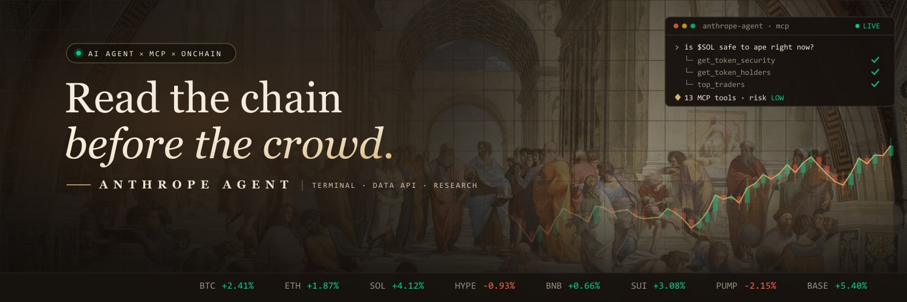

<p align="center">
  
</p>

<p align="center">
  
</p>

<h1 align="center">anthrope-agent-mcp</h1>

<p align="center">
  Live onchain market data for Claude, Cursor and any MCP client.<br />
  Prices, liquidity, holders, security scans, wallets, top traders, pump.fun trenches and Hyperliquid perps.
</p>

<p align="center">
  <a href="https://github.com/AnthropeAgent/anthrope-agent">GitHub</a> ·
  <a href="https://x.com/anthropeagent">X @anthropeagent</a>
</p>

---

This is the official MCP server of **Anthrope Agent**. It connects your AI assistant to the Anthrope Agent Data API so it can answer questions like *"Is this token safe?"* with real, current data instead of guesses.

**Read-only by design.** Every tool only reads. The server never signs, sends or simulates a transaction, and never asks for a wallet or private key.

## Quick start

You need **Node.js 20+** and an **Anthrope Agent API key** (`ak_…`). Create one on the Data API page after signing in with your wallet. The free plan includes 30K credits a month; each tool call uses one credit.

### Claude Code

```sh
claude mcp add anthrope-agent \
  -e ANTHROPE_API_KEY=ak_... \
  -e ANTHROPE_API_URL=https://YOUR-DOMAIN/api/v1 \
  -- npx -y anthrope-agent-mcp
```

### Claude Desktop and Cursor

Add this to `claude_desktop_config.json` (Claude Desktop) or `.cursor/mcp.json` (Cursor):

```json
{
  "mcpServers": {
    "anthrope-agent": {
      "command": "npx",
      "args": ["-y", "anthrope-agent-mcp"],
      "env": {
        "ANTHROPE_API_KEY": "ak_...",
        "ANTHROPE_API_URL": "https://YOUR-DOMAIN/api/v1"
      }
    }
  }
}
```

Restart the client and the `anthrope-agent` tools appear.

## Try asking

- "Is BONK on Solana safe? Check security and holder concentration."
- "Which trending Base tokens have more than $500K liquidity?"
- "What is wallet 0x… holding, and is it profitable?"
- "Are perps traders mostly long or short on ETH right now?"
- "Give me a market brief for Solana."

## Tools

| Tool | Returns |
| --- | --- |
| `search_tokens` | Tokens matching a symbol, name or contract address. Start here when you only know the name. |
| `list_tokens` | Trending, new, top market cap or RWA tokens, filtered by chain, timeframe, liquidity and market cap |
| `get_token` | Price, market cap, FDV, liquidity, volume, price change, transaction counts, launchpad |
| `get_token_security` | Contract scan: mint/freeze authority, honeypot, buy/sell tax, LP lock |
| `get_token_holders` | Top 100 holders and concentration (top 10 share and more) |
| `get_token_trades` | Latest swaps: side, USD size, wallet |
| `get_token_markets` | DEX pools for the token, with liquidity and volume per pool |
| `get_wallet` | Net worth, holdings, tracked PnL and activity for a Solana or EVM wallet |
| `top_traders` | Highest-PnL traders, globally or for one token (`chain:address`) |
| `pump_trenches` | pump.fun tokens by stage (new, final stretch, migrated) with bonding-curve progress |
| `perps_overview` | Hyperliquid markets (mark price, funding, open interest) and long/short split by wallet segment |
| `research_articles` | Published research and blog posts, or one full article by `slug` |
| `data_sources_status` | Data mode and freshness per chain |

## Prompts

| Prompt | What it does |
| --- | --- |
| `token_due_diligence` | Runs market, security, holder and trader checks on one token (`chain`, `address`) and ends with the main risks |
| `market_brief` | Builds a snapshot of the onchain market from trending tokens, trenches and perps, optionally for one `chain` |

## Configuration

| Variable | Default | Description |
| --- | --- | --- |
| `ANTHROPE_API_KEY` | none | Your Data API key, sent as the `x-api-key` header |
| `ANTHROPE_API_URL` | `http://localhost:4000/api/v1` | API base URL. Set this to the hosted API, or keep the default when you run the platform locally. |
| `ANTHROPE_TIMEOUT_MS` | `15000` | Request timeout in milliseconds |

Your key stays on your machine in the client config and is only sent to the API URL you set.

## Good to know

- Some data is prepared on demand. When a response says `pending`, call the same tool again after 5 to 15 seconds.
- Large responses are cut at 40,000 characters. Use `limit` or a narrower query to get less.
- A `401` means the key is missing or invalid; a `429` means you hit your plan's rate limit.
- Wallet PnL is computed from transactions the platform tracks, not the wallet's full history.

## Run from source

```sh
git clone https://github.com/AnthropeAgent/anthrope-agent.git
cd anthrope-agent && npm install
npm test -w anthrope-agent-mcp
npm start -w anthrope-agent-mcp
```

## Disclaimer

Market data comes from third parties and can be delayed or wrong. Security scans are automated checks, not audits. Responses are information, not investment advice.

Anthrope Agent is an independent project and is not affiliated with or endorsed by Anthropic. Claude is a trademark of Anthropic.
